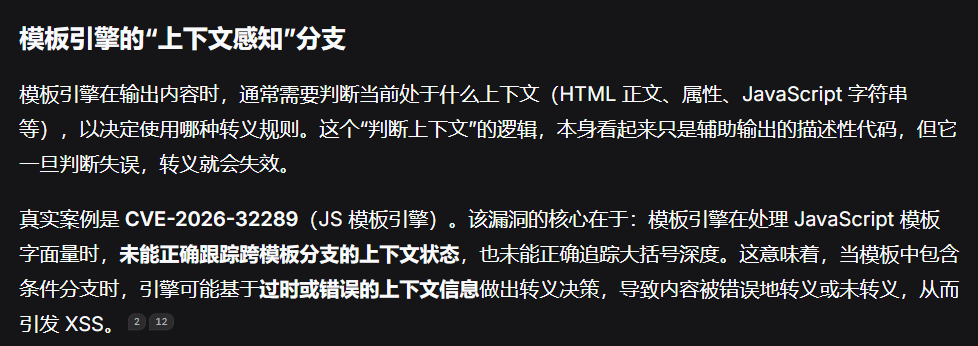
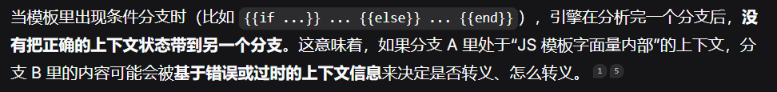
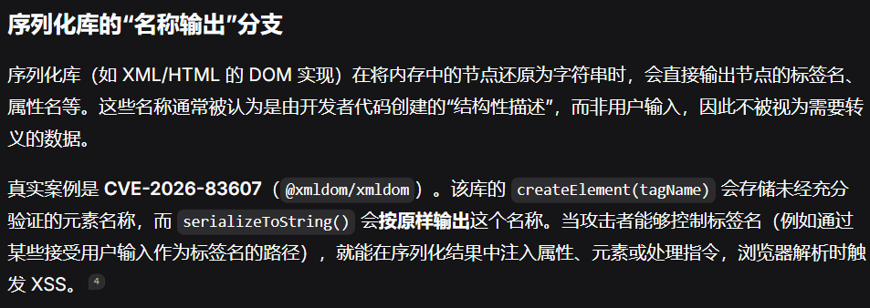
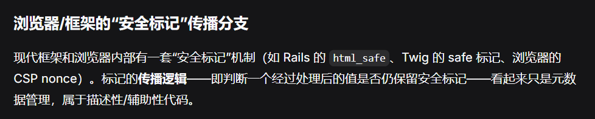
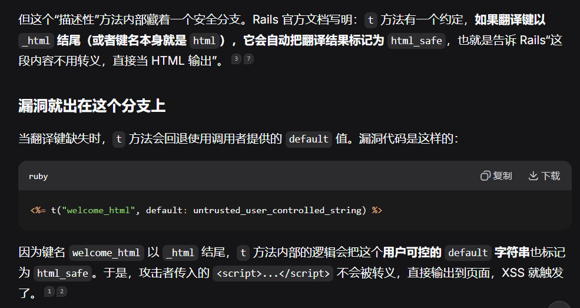

1. #### 覆盖率要不要去掉描述性代码（待整理）

   

   基于“描述性代码里藏着 XSS 安全判定分支”这一模式，可以抽象出几类在真实漏洞中反复出现的场景。它们的共同点是：代码表面上只负责“展示、格式化、优化或兼容”，却内含一个决定“是否转义/是否放行”的关键分支，而这个分支在覆盖率统计中极易被当作非核心逻辑排除。

   

   

   

   Rails Action View 翻译辅助方法的 XSS 漏洞（CVE-2020-15169）

   

   
