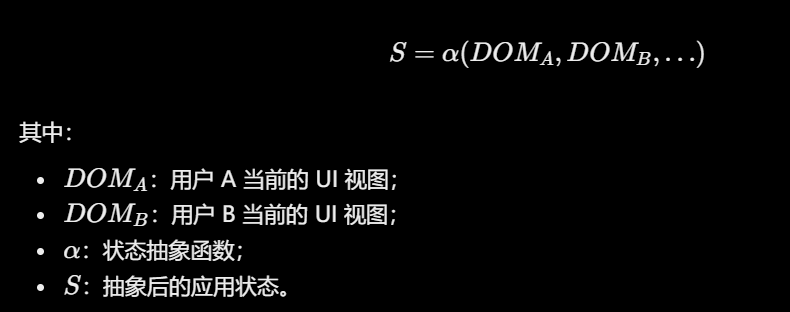
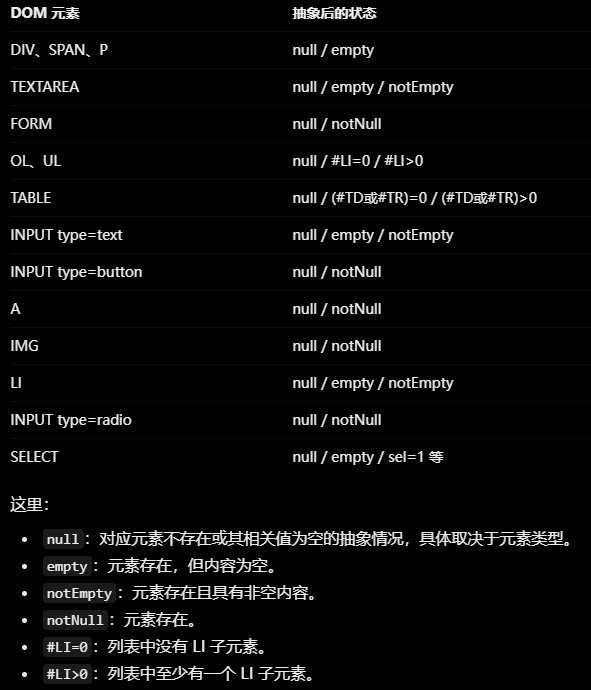
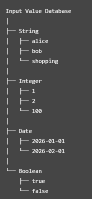
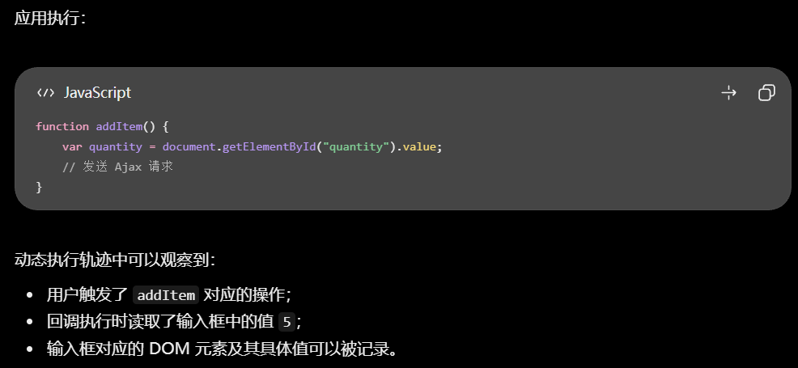
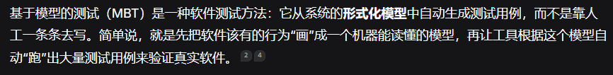

# 做什么

**目标**：如何把页面业务状态、页面内部 DOM 状态和表单填写经验统一起来，让爬虫能够根据状态变化持续更新可复用的交互规则。

**做法**：

模糊测试方法

可以先做这一阶段：构建双状态图，利用 LLM 进行状态语义理解、交互链路剪枝和历史填写值管理，最终生成状态感知表单填充规则。

这里有三个相互配合的部分：

1. 双状态图建模：分别描述页面之间的业务跳转关系，以及单个页面内部的 DOM 变化关系，然后可以用端到端令牌追踪判断跨边依赖关联
2. LLM链路优化：把相邻几个状态给它，理解状态含义，识别重复、无意义或冗余的交互链路，通过LLM MCP自行操纵浏览器的方式增强跨边依赖关联
3. LLM补充selenium代码，比如更多覆盖类型，达成某种前置条件等等（可以通过报错得知哪里做得不对，可以通过页面无法访问得知某个不该删除的元素被删除了，或者通过页面操作得知有哪些不该做的操作被执行了，或者通过页面操作对比html元素得知有哪些该做的操作没有做）

你不能只是让 LLM 帮助爬虫理解页面、补充 Selenium 代码，而应该让它利用历史交互反馈，持续发现、验证和更新 Web 应用中的状态依赖关系，最终形成可复用的状态感知交互规则。

每个状态记录一下这个状态是干嘛的以及我做了什么操作，做操作之后有什么变化之类的

**问题是如何被解决的**：

LLM补充selenium代码那一步可以被解决，起到一个增强作用，就是对于普通爬虫没有覆盖到的状态，由LLM补充

# 科研方法总结

怎么判断这个工作具不具有创新

- 问题相同、方法不同 → 差异在方法，你得说清方法带来什么新结论
- 方法相同、对象不同 → 为什么这个对象差异，会导致前人结论可能不成立、或前人方法可能不够用、或能揭示前人看不到的东西？
- 对象方法都同、场景不同 → 新场景让原方法/原结论失效或需要改造。

# 现实中的该类情况和其它论文的比较

## 页面状态会导致相同操作的结果出现差异

* 表单能否提交成功取决于多个表单外的依赖
  * 优惠券可用需要用户等级 `userLevel >= 2`且订单金额 `orderAmount >= 100`
  * 成功创建订单需要库存充足且用户余额足够
* 配置不同导致页面逻辑不同
  * CVE-2026-44568需要在settings页设置2个页面配置才能触发
  * DVWA不同难度下的攻击流程不同

## 爬虫爬取顺序与业务流程顺序并不一致

主要原因是后台菜单按功能模块划分，但订单处理流程是严格串行的，所以可能会在没有业务数据的时候就提前访问到了某个页面

| 应用                | 所属领域              | 具体功能                                   | GitHub Stars（约） |
| ------------------- | --------------------- | ------------------------------------------ | ------------------ |
| ERPNext             | ERP / 企业资源计划    | 财务、销售、采购、库存、制造、人力资源     | 41.2k              |
| Odoo                | ERP / 企业管理软件    | CRM、销售、库存、会计、制造、电商          | 56k                |
| OTRS / Znuny        | ITSM / IT 服务管理    | 工单、服务台、事件管理、问题管理、变更管理 | 593*               |
| Magento Open Source | E-commerce / 电子商务 | 商品目录、订单、支付、库存、客户管理       | 12.2k              |
| PrestaShop          | E-commerce / 电子商务 | 网店管理、商品、订单、客户、支付、售后     | 9.2k               |
| OpenEMR             | EHR / 医疗信息管理    | 电子病历、患者管理、预约、诊疗、账单       | 5.6k               |

## 相关工作

| 论文                                                         | 要解决的问题                                                 | 做法                                                         | 和本工作的差距                                               |
| ------------------------------------------------------------ | ------------------------------------------------------------ | ------------------------------------------------------------ | ------------------------------------------------------------ |
| Automated Web Application Testing: End-to-End Test Case Generation with Large Language Models and Screen Transition Graphs | 复杂导航、动态交互、条件表单使人工编写端到端测试成本高       | Selenium 爬取并建屏幕转换图；LLM 把图上的边写成具体操作      | 目标是生成端到端测试用例，只能考虑端到端的状态变化，而我们面向的是全局状态变化 |
| CrawlMLLM                                                    | 调用LLM里面页面语义触发多步操作才能触发的功能                | 用多模态大模型做三件事：从页面状态生成状态机、指导爬取顺序；分析元素功能与操作关系；生成模拟用户的操作 | 探索几乎交给模型，复杂页面处理能力差(LLM会漏掉部分功能)，鲁棒性差。<br>不具备根据历史交互确定当前应用状态的能力 |
| RESTler：Stateful REST API Fuzzing（ICSE 2019）              | 后续 API 依赖前面请求产生的资源，需要自动排出合法请求序列    | 按生产者–消费者关系排序。例如 A 创建虚拟机得到 `vm_id`，B 创建网络得到 `network_id`，C 把虚拟机接入网络时同时使用这两个标识 | 依赖建立在名称严格对应上。                                   |
| DANTE（ICST 2020）                                           | 找出爬虫原始轨迹中的依赖，确定最小测试用例套件。             | 从切割后的原始执行顺序出发。用例失败时，按原顺序把前面的用例外一个个加回来，看加上哪一个后当前用例恢复通过，从而确认依赖 | 发生在测试执行阶段，只对轨迹里已经出现过的依赖做顺序调整。探索时没走到的地方，这里补不出来 |
| Mining Workflow Models from Web Applications（TSE 2015）     | 复杂 Web 应用中的多用户业务工作流难以人工建模                | <br>通过观察操作前后活跃 UI 元素集合的变化建立业务状态变换图 | 需要研究者提前定义那些页面需要被监控                         |
| State-based Testing of Ajax Web Applications（ICST 2008）    | Ajax 应用中的事件交互和输入数据组合导致的状态变化问题        | **事件交互抽取**：它通过 DOM 状态抽象，将操作前后的页面变化转化为有限状态机，并利用状态转换关系指导后续测试用例生成。<br>其中DOM抽象规则分为通用抽象规则和应用专属抽象规则：<br>1. 通用抽象规则<br>2. 应用专属抽象规则：人工制定<br><br>**输入数据抽取**：从执行轨迹中收集输入值，建立按类型分类的输入值数据库，生成测试用例时根据回调函数需要的输入类型从数据库中随机选择一个值<br><br> | 主要面向 Ajax 页面内部的状态变化和事件交互，而不是跨页面业务流程依赖。 |
| Crawling Ajax-based Web Applications（TWEB 2012）            | Ajax 页面 URL 不变，但 DOM 和页面状态不断变化，如何建模这种变化 | 比较执行前后 DOM变化并推断状态机                             | 侧重页面内部状态，没有解决跨页面业务依赖                     |
| Automated Web Application Testing Driven by Pre-recorded Test Cases（JSS 2022） | 自动爬虫缺少业务知识，探索效率低                             | AWET 会记录人工操作过程中发生的事件、操作顺序和输入值；自动爬取时，如果遇到与记录规则对应的 Web 元素，就尝试应用这些人工操作顺序和输入值，从而引导后续探索 | 依赖已记录的交互经验，对尚未探索的依赖缺少主动推断能力       |
| FormWhisperer（ASE 2024）                                    | 表单字段存在复杂的单字段和多字段约束                         | 符号分析 HTML/JavaScript，提取并求解表单约束                 | 重点是当前表单内部约束，没有覆盖跨页面业务状态               |
| Using LLM to Fill in Web Forms（Information 2025）           | 随机表单输入效率低、提交成功判断不准确                       | T5(经过预训练的分类机器学习模型) 识别字段类型，Mocker(调用规则生成数据的数据生成工具)生成对应类型的输入，GPT-4o 辅助判断提交结果 | 侧重表单填充，没有建立跨页面业务状态依赖                     |
| MBTModelGenerator（JSS 2026）                                | Web 应用测试模型需要人工设计 | 从 Clickstream 反向生成 GraphWalker 状态转换模型             | 主要恢复已观察到的导航流程，缺少主动业务依赖分析             |
| Large Language Models for Automated Web-Form-Test Generation（TOSEM 2026） | LLM 生成表单测试时难以获取精准的上下文                       | 比较 11 种 LLM，并研究 HTML 结构剪枝和上下文构造             | 主要研究表单测试生成效果，不研究跨页面业务流程               |

# Make Agent Defeat Agent: Automatic Detection of Taint-Style Vulnerabilities in LLM-based Agents（USENIX Security Symposium 2025）

what：用攻击型LLM编写能触发漏洞的LLM提示词

why：

1. 传统模糊测试主要针对结构化输入进行字节级变异，无法理解自然语言 Prompt 的语义
2. 传统模糊测试难以在保持目标功能的同时满足 Sink 调用链中的参数约束
3. 传统距离反馈无法充分反映 Prompt 与目标组件之间的语义接近程度。

how：

1. 生成prompt

   * 预定义一批危险函数，例如 `eval()`、`exec()` 等并找到它们
   * 从危险函数开始反向遍历调用图，提取可能到达 Sink 的调用链。
   * 将调用链交给 LLM，让它生成能走这些调用链条的prompt

2. 完成测试LLM调用后给被调用的Prompt评分然后优先变异高分 Prompt。

   评分机制：

   

   * 语义层面：LLM结合执行轨迹中的类名、方法名与目标调用链进行语义比较并评分

   * 距离层面：根据实际执行轨迹中出现的方法，计算其到 Sink 的 CFG 最短距离。
     
   * 惩罚层面：对被反复选中的prompt进行减分，避免模糊测试陷入局部最优。

3. 变异

   - 功能变异器：根据执行反馈补充功能语义

     初始 Prompt：

     ```
     使用 Elasticsearch 搜索相关文档。
     ```

     调用的是普通搜索组件没有执行对应的文档权限检查

     变异后：

     ```
     使用 Elasticsearch 搜索相关文档，
     并执行对应的文档权限检查。
     ```

   - 参数变异器

     对比实际执行路径和目标 Sink 路径找到第一个未满足的条件分支

     求解满足约束的参数

     对原始prompt和求解出的参数使用最长公共子串匹配确定prompt哪些部分需要变异以满足约束

局限：

1. 多轮交互漏洞检测效果不好
2. 复杂参数约束可能解不出来
3. 论文需要预先定义危险函数集合，然后通过静态分析定位 Sink
4. AgentFuzz 利用类名、方法名推断组件功能，但是如果开发者使用无语义名称那么 LLM 可能难以准确理解目标组件的实际功能。
