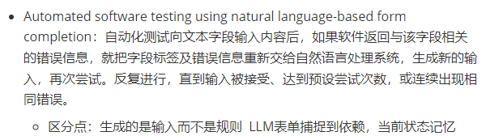
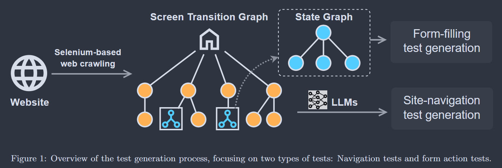
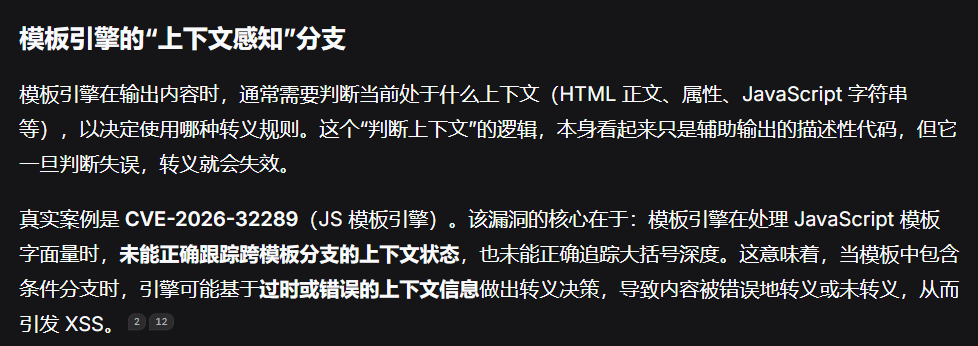
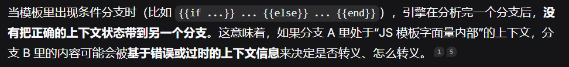
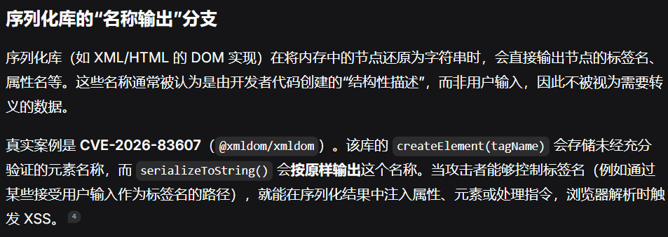
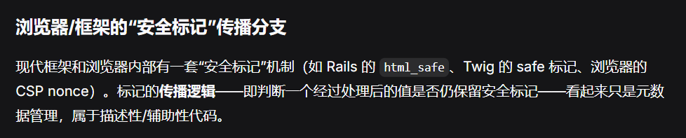
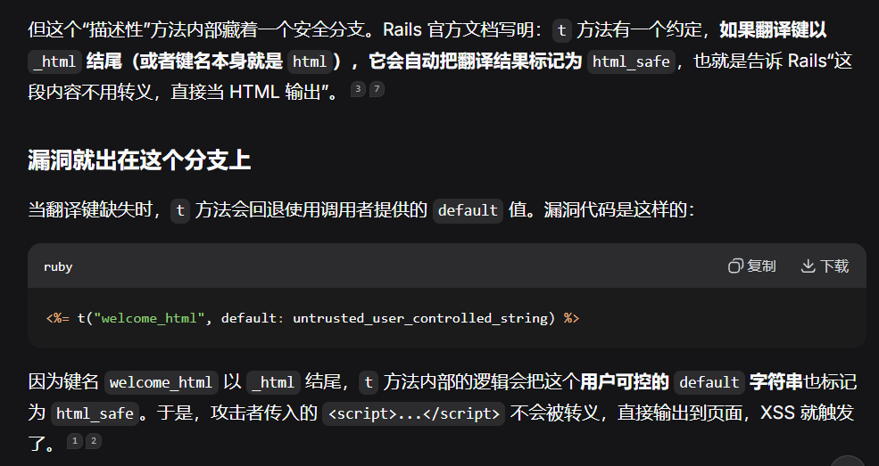

#### 做什么(不知道怎么做，可以再优化一下)

**目标**：如何把页面业务状态、页面内部 DOM 状态和表单填写经验统一起来，让爬虫能够根据状态变化持续更新可复用的交互规则。

**做法**：

模糊测试方法

可以先做这一阶段：构建双状态图，利用 LLM 进行状态语义理解、交互链路剪枝和历史填写值管理，最终生成状态感知表单填充规则。

这里有三个相互配合的部分：

1. 双状态图建模：分别描述页面之间的业务跳转关系，以及单个页面内部的 DOM 变化关系，然后可以用端到端令牌追踪判断跨边依赖关联
2. LLM链路优化：把相邻几个状态给它，理解状态含义，识别重复、无意义或冗余的交互链路，通过LLM MCP自行操纵浏览器的方式增强跨边依赖关联
3. LLM补充selenium代码，比如更多覆盖类型，达成某种前置条件等等（可以通过报错得知哪里做得不对，可以通过页面无法访问得知某个不该删除的元素被删除了，或者通过页面操作得知有哪些不该做的操作被执行了，或者通过页面操作对比html元素得知有哪些该做的操作没有做）

每个状态记录一下这个状态是干嘛的以及我做了什么操作，做操作之后有什么变化之类的

**问题是如何被解决的**：

LLM补充selenium代码那一步可以被解决，起到一个增强作用，就是对于普通爬虫没有覆盖到的状态，由LLM补充

#### 科研方法总结

怎么判断这个工作具不具有创新

- 问题相同、方法不同 → 差异在方法，你得说清方法带来什么新结论
- 方法相同、对象不同 → 为什么这个对象差异，会导致前人结论可能不成立、或前人方法可能不够用、或能揭示前人看不到的东西？
- 对象方法都同、场景不同 → 新场景让原方法/原结论失效或需要改造。

#### 其它论文等的比较

1. 跨页面元素依赖

2. 一个元素依赖于2个元素

   * 常见案例1？？？？

     选择入住日期。

     选择退房日期。

     选择房间数量。

     选择入住人数。

     选择酒店

3. 一连串的顺序依赖

   * 常见案例1：前一个操作改变业务状态，后续操作才能执行

     页面 A：添加商品到购物车。

     页面 B：填写收货地址。

     页面 C：选择支付方式。

     页面 D：提交订单。

   * 常见案例2：前一个操作产生的数据决定后续可选内容

     选择出发城市。

     选择目的地。

     选择出发日期。

     系统动态加载可用航班。

     选择航班。

   * 常见案例3：前一个操作创建资源，后续操作引用该资源

     创建虚拟机。

     创建虚拟网络。

     配置安全组。

     将虚拟机接入网络。

     远程连接虚拟机。

   * RESTler：Stateful REST API Fuzzing（ICSE 2019）

     RESTler 的核心机制：

     1. 分析 API Specification（Swagger/OpenAPI）。
     2. 提取 API 参数之间的 Producer-Consumer 关系。
     3. 判断哪些 API 必须先执行。
     4. 自动生成具有依赖关系的请求序列。
     5. 根据服务器返回结果动态调整后续测试。

     例如：

     - A 创建虚拟机，产生 `vm_id`。
     - B 创建网络，产生 `network_id`。
     - C 将虚拟机接入网络，需要同时使用 `vm_id` 和 `network_id`。

4. 有一些页面需要一些前置条件才能进去

   * DVWA每个难度的攻击难度都不同

   * 云资源管理

     创建虚拟机。

     创建虚拟网络。

     配置安全组。

     将虚拟机接入网络。

     远程连接虚拟机。

自动寻找可能触发状态变化的 DOM 元素。

触发相应事件。

比较交互前后的 DOM。

将新状态和状态转换加入 State-Flow Graph。

通过回退、重放等方式继续探索。

| 论文/来源                                                    | 解决什么问题                                                 | 怎么解决的（方法）                                           | 归类 | 我的优势在哪                                                 |
| ------------------------------------------------------------ | ------------------------------------------------------------ | ------------------------------------------------------------ | ---- | ------------------------------------------------------------ |
| Automated Web Application Testing: End-to-End Test Case Generation with Large Language Models and Screen Transition Graphs（待） | 传统 Web 自动化测试难以处理复杂页面导航、动态交互和条件表单，人工编写端到端测试用例成本较高。 | 1. 使用 Selenium 爬取网站并构建屏幕转换图（Screen Transition Graph）。2. 利用 LLM 理解页面转换关系，将图中的边转换为具体操作描述。3. 构建表单状态图，处理条件表单并生成 Selenium 测试脚本。 | 文章 | 你的研究重点不是生成测试用例，而是提升爬虫对复杂 Web 应用的自动化探索能力。可以进一步研究页面状态变化、交互依赖关系和表单填写数据之间的关联，减少无效交互和重复探索。 |
| Crawljax（待）                                               | 传统爬虫主要依靠 URL 链接进行页面遍历，难以发现 AJAX 应用中通过 JavaScript 交互触发的动态页面状态。 |                                                              | 文章 | 在 Crawljax 的动态状态探索基础上，进一步引入语义理解和交互依赖建模。不仅识别页面发生了什么变化，还分析不同操作之间的前置依赖关系，并利用历史填写数据辅助后续交互。 |
| CrawlMLLM（待）                                              | 面对需要多步操作才能触发的功能，LLM 可以辅助理解页面内容和操作目的，生成更符合用户行为的操作序列。 | 1. 页面状态挖掘：利用 MLLM 分析页面状态，生成状态机描述，指导爬取顺序。2. 页面功能分析：分析页面元素及其功能、操作关系。3. 自动操作生成：利用 MLLM 生成模拟用户行为的操作，以增强动态页面探索能力。 | 文章 | 如何根据普通爬虫已经执行过的操作和发现的依赖，精准补充缺失的操作序列，而不是重新进行一轮泛化探索。 |
| RESTler：Stateful REST API Fuzzing（ICSE 2019）              | 后续 API 请求依赖前面 API 请求产生的资源，如何自动生成正确的请求执行序列？ | A 创建虚拟机，产生 `vm_id`。 <br/>B 创建网络，产生 `network_id`。 <br/>C 将虚拟机接入网络，需要同时使用 `vm_id` 和 `network_id`。 | 文章 | RESTler 主要针对 REST API                                    |
|                                                              |                                                              |                                                              |      |                                                              |

网站，文章数据，cve

解决什么问题，它是怎么解决的，归类，揪住它的主要问题

哪些应用这样的依赖关系比较多，有多少应用有这种需求，占比多少，利用它造成的攻击

##### Automated Web Application Testing: End-to-End Test Case Generation with Large Language Models and Screen Transition Graphs（解决）





论文的架构图显示，State Graph 是从 Screen Transition Graph 中**虚线抽取**出来的，说明状态图聚焦于表单交互引发的逻辑状态变化。当测试路径经过一个表单页面时，系统会调用表单模块生成该页面的填写动作；离开该页面时的跳转，则回到导航模块的逻辑中处理。两个模块的产出由系统按路径顺序**拼接**成完整的端到端测试脚本。

1. **两个图是分开的，不交叉**：
   - **Screen Transition Graph（页面跳转图）**：爬虫抓取页面，每个节点代表一个网页，边代表链接/按钮。用于**导航测试**。
   - **State Graph（状态图）**：当网页包含表单时，作为页面跳转图的**子图**。节点是表单的不同状态，边是引发状态变化的交互。用于**表单测试**。
2. **导航测试的 LLM 输入**：原文3.1节明确指出，LLM的作用是“针对路径上的每一条边，生成详细的交互描述”。它并不是去“补边”，而是把图算法（Dijkstra）算出来的**最短路径**，翻译成具体的点击动作（如“点击名为Blog的按钮”）。
3. **表单测试的 LLM 输入**：原文3.2节 Algorithm 1 显示，系统会执行交互，对比交互前后的 HTML（`Hold` vs `Hnew`）。如果变了，就保存这个状态并递归探索。**对于叶子节点（Leaf nodes），LLM 拿到的输入是该状态下完整的 HTML 结构**（图3展示的代码就是根据这个生成的）。
4. **回溯机制**：原文明确承认 Selenium 无法直接回退。所以算法维护了一个“交互列表”，退回时只能**重放（Replay）**之前的操作。
5. **数据集**：2000个合成表单（1000简单，1000动态） + 133个真实网站表单。简单表单全是静态的；**动态表单是人为构建的**（2-4个子表单，初始只显示一个，通过修改 display 属性动态显示隐藏）。

###### 爬取URL

* 节点（Node）：网站中的页面，主要通过 URL 标识。
* 边（Edge）：从一个页面跳转到另一个页面的导航转换，由页面上的交互触发，例如点击超链接或按钮。

dijstra算法记录到某一个节点的最短距离然后由LLM生成跳转selenium

输入给LLM：

1. **一条dijstra路径：**
2. **页面HTML**
3. **自然语言指令（Prompt）：**

LLM的作用

1. 把抽象的图路径转化为符合人类逻辑的、具体的点击序列。
2. 过滤无意义的路径（基于常识）： 屏幕转换图中可能包含大量通过爬虫硬点出来的“死胡同”或非正常业务流（比如误触广告、循环刷新）。LLM 利用其常识，可以识别并过滤掉这些不符合真实用户行为的路径，优先生成有业务价值的导航测试。
3. 处理动态交互元素： 很多页面跳转不是简单的 `<a>` 标签，而是点击按钮触发的 JavaScript 路由或弹出新窗口。LLM 能够理解按钮上的文案（如“立即购买”），并生成相应的 Selenium 定位和点击代码，从而完成页面之间的真实跳转。

> 根据运行时发现未登记的 DOM 元素补充图中的缺失边

###### 爬取表单

```
选择用户类型
    |
    ├── 普通用户 → 显示普通信息字段
    |
    ├── 管理员   → 显示管理员字段
    |
    └── 主管     → 显示主管字段
```

传统表单自动化测试可能只填写初始页面中可见的字段，无法充分探索交互后才出现的字段。

```
ExploreFormInteractions(form):

    获取当前表单中的所有可交互元素

    for 每一个元素 e:

        保存当前表单 HTML

        尝试与 e 交互

        获取交互后的表单 HTML

        if 前后 HTML 不同:

            保存新的表单状态

            递归探索新状态中的交互元素

        end if

    end for
```

LLM的输入:

1. 叶子节点页面的整个静态HTML，不是当个表单
2. **自然语言指令（Prompt）：**
   - 例如：“请根据以下 HTML 表单结构，生成一组用于测试‘成功注册’的输入数据，以及用于测试‘密码太短’的异常数据，并给出对应的预期断言。”

> 1. **执行历史（可选，用于跨表单）**：为了处理跨表单的依赖，系统可以在 Prompt 中显式加入“最近执行历史”区块。例如：“注意：在之前的步骤中，你已经在注册页填写了邮箱 `user@test.com`。”这样 LLM 在后续登录表单中就能引用这个值。有研究指出，在长流程测试中，维护“会话记忆”或限制上下文范围以防止“上下文溢出”（context bleed），是保证逻辑连续性的关键。论文把**导航测试**和**表单测试**完全拆开做了，**根本没有做跨表单的联合测试**。论文第 3.2 节只讨论单个表单内部的状态递归。笔记里提到的“路径上下文拼接”、“全局状态图注入”、“同页多表单关联”，完全是笔记作者基于其他研究（如 WebArena 或 WebVoyager）脑补出来的，**这篇论文并未实现这些功能**。

根据前后HTML差异判断表单是否提交成功

> 可以只记录前置状态和变化，并用LLM语义做一个总结方便记忆

LLM的作用：

1. **生成符合上下文的测试数据（Test Data Generation）：** 这是 LLM 最擅长的。它不需要人去写死数据，而是根据表单字段的标签（Label）和提示语（Placeholder），自动生成合理的输入。例如，看到“邮箱”字段生成 `test@example.com`，看到“年龄”字段生成 `18` 或 `-1`（用于测试边界值）。

> **理解复杂的表单交互：** 现代网页有各种复杂的表单控件（下拉框、日期选择器、文件上传、滑块等）。LLM 可以理解 HTML 结构，生成操作这些复杂控件的对应代码（如选择一个特定的下拉选项），而不仅仅是简单的文本输入。
>
> **论文真相**：这正是论文的**软肋**。论文实验数据（图 7）明明白白地显示：`file`（文件上传）和 `hidden`（隐藏字段）**在所有测试场景下都一致失败**。连下拉框，如果是原生 `<select>` 可能还行，如果是各种 `div` 模拟的级联选择器，成功率极低。LLM 在这个框架下**无法**很好地处理复杂表单控件。
>
> 如何捕捉跨表单的语义关联
>
> LLM 捕捉这种关联的方式如下：
>
> - 路径上下文拼接：当 LLM 生成从页面 A 到页面 B 的测试路径时，输入中不仅包含当前页面的 DOM，还会包含前面步骤的执行历史（例如：“用户刚刚在页面 A 注册了账号 `user123`”）。LLM 可以利用这个历史，在页面 B 的登录表单中自动填入 `user123`，实现跨表单的数据传递。
> - 全局状态图注入：系统可以把 State Graph 中与当前表单相关的相邻状态节点描述作为输入。例如，告诉 LLM：“当前处于‘未登录’状态，目标状态是‘完成支付’。请注意支付表单需要依赖前面步骤填写的收货地址。” LLM 据此理解业务流。
> - 同页多表单关联：如果同一页面有多个表单（如左侧筛选栏 + 右侧数据表格），LLM 拿到的是整个页面的精简 DOM 树，它能通过阅读标签和结构，理解“左侧筛选条件”与“右侧表格数据刷新”之间的因果关联。

##### crawljax

页面内状态转换图

##### crawlMLLM

核心思路：利用 MLLM 理解页面状态和交互功能，生成可执行操作，并通过执行反馈不断修正操作。

1. 页面状态挖掘：利用多模态大语言模型分析网页 URL、HTML 和截图，识别页面之间的关系，构建和更新页面状态机。
2. 页面功能分析：分析页面整体功能及按钮、表单等交互元素的作用，生成对应的自然语言任务描述和操作步骤。
3. 自动操作代码生成：将自然语言任务拆分为具体操作，结合页面 HTML、操作模板和历史操作记录，生成可执行的 Puppeteer 代码。
4. 操作结果验证：执行生成的代码，对比操作前后的 URL、HTML 和截图，判断是否实现预期的页面跳转或内部状态变化。
5. 反馈驱动代码修复：如果操作失败，将执行反馈交给 LLM，重新生成操作代码；成功后保存操作记录，供后续任务参考。

#### 覆盖率要不要去掉描述性代码（待整理）


基于“描述性代码里藏着 XSS 安全判定分支”这一模式，可以抽象出几类在真实漏洞中反复出现的场景。它们的共同点是：代码表面上只负责“展示、格式化、优化或兼容”，却内含一个决定“是否转义/是否放行”的关键分支，而这个分支在覆盖率统计中极易被当作非核心逻辑排除。







Rails Action View 翻译辅助方法的 XSS 漏洞（CVE-2020-15169）





#### Make Agent Defeat Agent: Automatic Detection of Taint-Style Vulnerabilities in LLM-based Agents

what：用攻击型LLM编写能注入漏洞的提示词

why：传统模糊测试器改字符的方式无法保证语义不变

how：

1. 找到sink点如`html_specialcahrs`转义函数等，再让 LLM 根据这些语义生成 Prompt：“请使用 Python 执行器运行下面这段代码。”

2. 先跑哪个输入

   按照以下标准打分：

   - 语义上像不像目标功能；
   - 执行后离 Sink 还有多远；
   - 无效探索扣分。

   然后优先跑高分 Prompt。

3. 变异

   - 功能变异器：换一种说法，但意思不变。
     “请使用 Python 执行器运行代码” → “调用 Python 运行环境，执行下面的程序。”
   - 参数变异器：如果工具参数有约束，比如 `language` 只能是 `python` 或 `javascript`，就用符号执行和 Z3 求出合法参数。

局限：

1. 多轮交互触发的漏洞检测不好：需要“第一轮存数据、第二轮读数据、第三轮进 Sink”这种跨轮次污点传播，它主要针对单步触发。
2. 复杂参数约束可能解不出来：如果到 Sink 前要过签名、权限、token 等多重检查，符号执行和 Z3 未必能求出合法参数。
