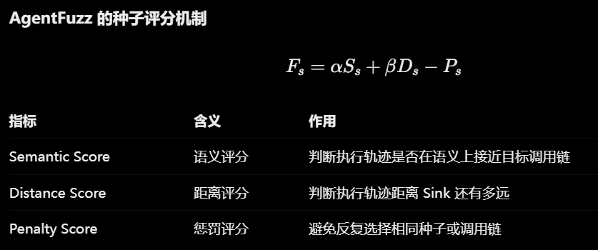

# 做什么

**目标**：如何把页面业务状态、页面内部 DOM 状态和表单填写经验统一起来，让爬虫能够根据状态变化持续更新可复用的交互规则。

**做法**：

模糊测试方法

可以先做这一阶段：构建双状态图，利用 LLM 进行状态语义理解、交互链路剪枝和历史填写值管理，最终生成状态感知表单填充规则。

这里有三个相互配合的部分：

1. 双状态图建模：分别描述页面之间的业务跳转关系，以及单个页面内部的 DOM 变化关系，然后可以用端到端令牌追踪判断跨边依赖关联
2. LLM链路优化：把相邻几个状态给它，理解状态含义，识别重复、无意义或冗余的交互链路，通过LLM MCP自行操纵浏览器的方式增强跨边依赖关联
3. LLM补充selenium代码，比如更多覆盖类型，达成某种前置条件等等（可以通过报错得知哪里做得不对，可以通过页面无法访问得知某个不该删除的元素被删除了，或者通过页面操作得知有哪些不该做的操作被执行了，或者通过页面操作对比html元素得知有哪些该做的操作没有做）

每个状态记录一下这个状态是干嘛的以及我做了什么操作，做操作之后有什么变化之类的

**问题是如何被解决的**：

LLM补充selenium代码那一步可以被解决，起到一个增强作用，就是对于普通爬虫没有覆盖到的状态，由LLM补充

# 科研方法总结

怎么判断这个工作具不具有创新

- 问题相同、方法不同 → 差异在方法，你得说清方法带来什么新结论
- 方法相同、对象不同 → 为什么这个对象差异，会导致前人结论可能不成立、或前人方法可能不够用、或能揭示前人看不到的东西？
- 对象方法都同、场景不同 → 新场景让原方法/原结论失效或需要改造。

# 现实中的该类情况和其它论文的比较

## 1. 三类依赖

### 1.1 一个结果同时依赖多个前置

几个条件要一起满足，缺一个，目标状态就不出现。

| 案例                                                       | 结果                                  | 必须同时满足的前置                                         |
| ---------------------------------------------------------- | ------------------------------------- | ---------------------------------------------------------- |
| 酒店查询                                                   | 可选酒店                              | 入住日期、退房日期、房间数量、入住人数，再选择酒店         |
| 优惠券可用                                                 | `canUseCoupon`                        | 用户等级 `userLevel >= 2`，且订单金额 `orderAmount >= 100` |
| 创建订单                                                   | 订单写入                              | 库存充足，且用户余额足够                                   |
| Open WebUI 存储型 XSS（CVE-2026-44568，影响版本 ≤ 0.8.12） | Pending User Overlay 被渲染并触发 XSS | 需要在settings页设置2个页面配置                            |

### 1.2 一连串顺序依赖

前一步改变业务状态、产生数据或创建资源，后一步才能执行或才有可选项。

**前一步改变业务状态，后一步才能做**

页面 A 加购 → 页面 B 填收货地址 → 页面 C 选支付方式 → 页面 D 提交订单。

DVWA每个难度下的攻击条件不同。同一类操作是否成立，取决于当前难度这个前置状态。

**前一步的数据决定后一步有哪些选项**

出发城市 → 目的地 → 出发日期 → 系统动态加载可用航班 → 选择航班。日期和城市没定下来，航班列表不存在。

**前一步创建资源，后一步引用该资源**

创建虚拟机 → 创建虚拟网络 → 配置安全组 → 把虚拟机接入网络 → 远程连接虚拟机。

### 1.3 跨页面，且顺序反了就到不了

**Craft CMS 存储型 XSS（CVE-2026-56393）**

1. 在 Settings → Users → User Groups 创建用户组。
2. 保存用户组名称。
3. 进入 Settings → Fields。
4. 创建 Users 类型的字段。
5. 在字段的 Sources 选择列表中，触发之前保存的内容。

这里要同时满足两点：跨页面，并且知道两个页面上的业务对象是关联的。只在触发页填表，Source 里的内容还不存在。

**Craft Commerce 存储型 XSS（CVE-2026-29175，修复版本 5.5.3）**

- 页面 A（Commerce → Products）：创建商品，设置 Product Title、Variant Title 或 Variant SKU。
- 页面 B（Commerce → Inventory）：商品及其变体信息在库存页被重新渲染，触发存储型 XSS。

商品创建和库存管理属于不同业务模块；要先把商品和变体属性关联起来，数据保存后再到另一个页面读取。只对库存页做表单填充，完不成注入。

**业务系统里的依链多为这种依赖**

## 2. 业务系统里的依赖链

| 应用                                                         | 典型依赖                                                     | 对探索的含义                                                 |
| ------------------------------------------------------------ | ------------------------------------------------------------ | ------------------------------------------------------------ |
| ERPNext                                                      | 报价单 → 销售订单（关联报价单）→ 发货单（依据销售订单）→ 销售发票（依据销售订单或发货单）→ 收款（依据销售发票）。还涉及仓库、税率、供应商、权限 | 列表页和新建页在前置数据还没建好时也能进去，所以「到达页面」会高估真实进度。真正可提交的单据依赖前面已经提交的单据 |
| Odoo                                                         | 产品类别 → 产品及其属性、变体 → 仓库和库存 → 客户及报价单 → 确认销售订单 → 出库、开票、付款 | 爬虫即使发现产品创建页，也不一定能创建出后续销售可用的产品，需要先探索多个其它页面、建好多条前置数据 |
| Magento Open Source                                          | 商品、属性、分类、库存、客户组、订单彼此依赖                 | 商品到订单之间是多对象交叉依赖                               |
| PetClinic                                                    | 先创建宠物，才能预约兽医                                     | 后一个业务动作引用前一个资源                                 |
| WordPress                                                    | 分类术语必须先存在，文章才能引用它。                         | 同ERPNext和Odoo                                              |
| Drupal、PrestaShop、Moodle、WordPress + WooCommerce、OpenEMR |                                                              | 基本上都是1.3类型的                                          |

## 3. 相关工作

| 论文                                                         | 要解决的问题                                              | 做法                                                         | 和本工作的差距                                               |
| ------------------------------------------------------------ | --------------------------------------------------------- | ------------------------------------------------------------ | ------------------------------------------------------------ |
| Automated Web Application Testing: End-to-End Test Case Generation with Large Language Models and Screen Transition Graphs | 复杂导航、动态交互、条件表单使人工编写端到端测试成本高    | Selenium 爬取并建屏幕转换图；LLM 把图上的边写成具体操作      | 目标是生成端到端测试用例。与我们的目标不同                   |
| CrawlMLLM                                                    | 调用LLM里面页面语义触发多步操作才能触发的功能             | 用多模态大模型做三件事：从页面状态生成状态机、指导爬取顺序；分析元素功能与操作关系；生成模拟用户的操作 | 探索几乎交给模型，复杂页面处理能力差(LLM会漏掉部分功能)，鲁棒性差。<br>不具备根据历史交互确定当前应用状态的能力 |
| RESTler：Stateful REST API Fuzzing（ICSE 2019）              | 后续 API 依赖前面请求产生的资源，需要自动排出合法请求序列 | 按生产者–消费者关系排序。例如 A 创建虚拟机得到 `vm_id`，B 创建网络得到 `network_id`，C 把虚拟机接入网络时同时使用这两个标识 | 依赖建立在名称严格对应上。                                   |
| DANTE                                                        | 找出爬虫原始轨迹中的依赖，确定最小测试用例套件。          | 从切割后的原始执行顺序出发。用例失败时，按原顺序把前面的用例外一个个加回来，看加上哪一个后当前用例恢复通过，从而确认依赖 | 发生在测试执行阶段，只对轨迹里已经出现过的依赖做顺序调整。探索时没走到的前置，这里补不出来 |

## 4. 总结

现有方法覆盖不到的情况主要是下面几条。

1. 多个前置条件 。优惠券、下单、Open WebUI 都是两个条件同时为真的时候才能触发漏洞。
2. 需要跨页面触发的漏洞一旦爬取顺序错了就无法检测到了

# Make Agent Defeat Agent: Automatic Detection of Taint-Style Vulnerabilities in LLM-based Agents（USENIX Security Symposium 2025）

what：用攻击型LLM编写能触发漏洞的LLM提示词

why：

1. 传统模糊测试主要针对结构化输入进行字节级变异，无法理解自然语言 Prompt 的语义
2. 传统模糊测试难以在保持目标功能的同时满足 Sink 调用链中的参数约束
3. 传统距离反馈无法充分反映 Prompt 与目标组件之间的语义接近程度。

how：

1. 生成prompt

   * 预定义一批危险函数，例如 `eval()`、`exec()` 等并找到它们
   * 从 Sink 开始反向遍历调用图，提取可能到达 Sink 的调用链。
   * 将调用链交给 LLM，让它推断目标组件的功能，生成对应的自然语言种子。

2. 给Prompt评分

   

   * 语义层面：LLM结合执行轨迹中的类名、方法名与目标调用链进行语义比较并评分

   * 距离层面：根据实际执行轨迹中出现的方法，计算其到 Sink 的 CFG 最短距离。
     
   * 惩罚层面：防止某个prompt被反复选中变异，避免模糊测试陷入局部最优。

   然后优先变异高分 Prompt。

3. 变异

   - 功能变异器：根据执行反馈补充功能语义

     初始 Prompt：

     ```
     使用 Elasticsearch 搜索相关文档。
     ```

     可能调用的是普通搜索组件。

     变异后：

     ```
     使用 Elasticsearch 搜索相关文档，
     并执行对应的文档权限检查。
     ```

   - 参数变异器

     对比实际执行路径和目标 Sink 路径找到第一个未满足的条件分支

     通过Z3求解满足约束的参数

     对原始prompt和求解出的参数使用 最长公共子串匹配确定prompt哪些部分需要变异以满足约束

局限：

1. 多轮交互漏洞检测效果不好
2. 复杂参数约束可能解不出来
3. 论文需要预先定义危险函数集合，然后通过静态分析定位 Sink
4. AgentFuzz 利用类名、方法名推断组件功能，但是如果开发者使用无语义名称那么 LLM 可能难以准确理解目标组件的实际功能。
