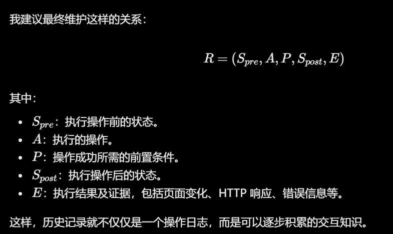

# 做什么

**目标**：如何把页面业务状态、页面内部 DOM 状态和表单填写经验统一起来，让爬虫能够根据状态变化持续更新可复用的交互规则。

**做法**：

模糊测试方法

可以先做这一阶段：构建双状态图，利用 LLM 进行状态语义理解、交互链路剪枝和历史填写值管理，最终生成状态感知表单填充规则。

这里有三个相互配合的部分：

1. 双状态图建模：分别描述页面之间的业务跳转关系，以及单个页面内部的 DOM 变化关系，然后可以用端到端令牌追踪判断跨边依赖关联
2. LLM链路优化：把相邻几个状态给它，理解状态含义，识别重复、无意义或冗余的交互链路，通过LLM MCP自行操纵浏览器的方式增强跨边依赖关联
3. LLM补充selenium代码，比如更多覆盖类型，达成某种前置条件等等（可以通过报错得知哪里做得不对，可以通过页面无法访问得知某个不该删除的元素被删除了，或者通过页面操作得知有哪些不该做的操作被执行了，或者通过页面操作对比html元素得知有哪些该做的操作没有做）

你不能只是让 LLM 帮助爬虫理解页面、补充 Selenium 代码，而应该让它利用历史交互反馈，持续发现、验证和更新 Web 应用中的状态依赖关系，最终形成可复用的状态感知交互规则。

每个状态记录一下这个状态是干嘛的以及我做了什么操作，做操作之后有什么变化之类的

1. B 的执行依赖某个业务对象。
2. 爬虫第一次探索 B 时，该对象不存在。
3. A 与 B 没有直接导航关系。
4. 爬虫需要从其他页面发现 A。
5. 还需要将 A 的执行结果与之前 B 的失败关联起来。
6. 最后主动恢复 B 的执行。

**问题是如何被解决的**：

LLM补充selenium代码那一步可以被解决，起到一个增强作用，就是对于普通爬虫没有覆盖到的状态，由LLM补充

