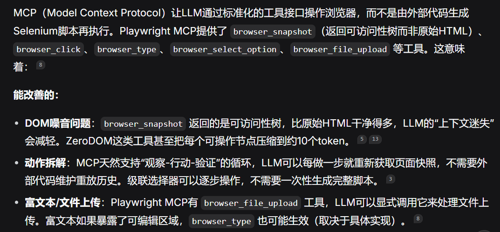

#### 做什么

**目标**：如何把页面业务状态、页面内部 DOM 状态和表单填写经验统一起来，让爬虫能够根据状态变化持续更新可复用的交互规则。

**做法**：

模糊测试方法

可以先做这一阶段：构建双状态图，利用 LLM 进行状态语义理解、交互链路剪枝和历史填写值管理，最终生成状态感知表单填充规则。

这里有三个相互配合的部分：

1. 双状态图建模：分别描述页面之间的业务跳转关系，以及单个页面内部的 DOM 变化关系。
2. LLM 语义分析与链路优化：理解状态含义，识别重复、无意义或冗余的交互链路。
3. 历史填写值与规则生成：记录每个状态下的填写情况，为后续状态提供上下文，生成可执行的填充规则。

**对于之前内容的总结**：

1. 厘清页面跳转之间的依赖链，把导致其跳转到另一个页面的元素记录下来，因为不同页面之间的元素可能是存在依赖关系的
2. 权限切换后才会显露出来的漏洞

3. 可以填充：增加记忆复用，比如之前填入名字X，之后在不同表单碰到名字字段的时候直接复用；构建表单字段依赖图，当字段 B 依赖字段 A 时，模型不仅要考虑 B 的取值，还要考虑 A 的状态和二者的约束。修复结果也可以附带适用条件，避免把偶然成功的输入误认为普遍有效的规则；

4. 变异payload

   * 只注入 ``，payload单一，其中有一些payload构造比较复杂，比如必须放到Imgur 返回的 HTML 里而不是只是放一个payload到特定应用中

     属性突破、javascript:、jQuery $()、oEmbed HTML、剪贴板、CSP 拦 inline script，全部不算。

     “属性突破”

     指通过闭合 HTML 属性引号（如 `value="..."` 中注入 `">`）来注入新属性或标签。被排除，说明目标页面在属性上下文中的转义是可靠的，或者注入点不在属性里，这条路走不通。

     “javascript:”

     指利用 `href="javascript:..."` 这类伪协议执行脚本。被排除，说明目标没有可控的 `href`/`src` 注入点，或者有协议白名单拦截。

     “jQuery $()”

     指利用 jQuery `$()` 对选择器/HTML 的解析歧义来执行代码（就像你之前问的 kses 绕过思路）。被排除，说明目标前端没有把可控输入传入 `$()` 的危险用法，或 jQuery 版本已修复该歧义。

     “oEmbed HTML”

     指通过 oEmbed 嵌入返回的 HTML 注入脚本。被排除，说明 oEmbed 响应经过净化，或该功能不可控。

     “剪贴板”

     指通过剪贴板 API 或粘贴内容触发脚本。被排除，说明没有可利用的剪贴板相关注入面。

     “CSP 拦 inline script”

     Content-Security-Policy 是服务器通过 HTTP 响应头（或 meta 标签）告诉浏览器“这个页面只允许加载/执行哪些资源”的安全机制。

5. IDOR

   * 只测试get类型的idor漏洞，post类型的不测
   * 它不会去篡改 URL 里的 `id`、`project_id`、`p=`、`file_id` 这些参数，而是在同一组参数下，换不同 cookie 看响应差异来判断越权。

6. 事件顺序未满足：需要待审评论 + 管理员在评论页点击

7. 痛点一：【点了一个按钮，URL 根本没变，但页面内容变了】这种状态难以建模

8. 痛点二：【只有当用户先买了“A商品”，又评价了“B商品”，最后在“C页面”提交一段文字时，系统才会把那行文字吐出来】这种页面之间的顺序依赖难以发现，或者说是一个点依赖于2个点

9. 痛点三：页面过滤可能没考虑当前状态没有满足前置情况

#### 关于当前工作的碎碎念

1. 重点：跳过前置操作直接定位到执行这些前置操作后页面变化部分的方法

2. 可以用LLM  MCP

   

3. 不要给LLM完整HTML，要做DOM的精简和变化提取
4. 测试方法也许可以参考一下Automated Web Application Testing: End-to-End Test Case Generation with Large Language Models and Screen Transition Graphs

