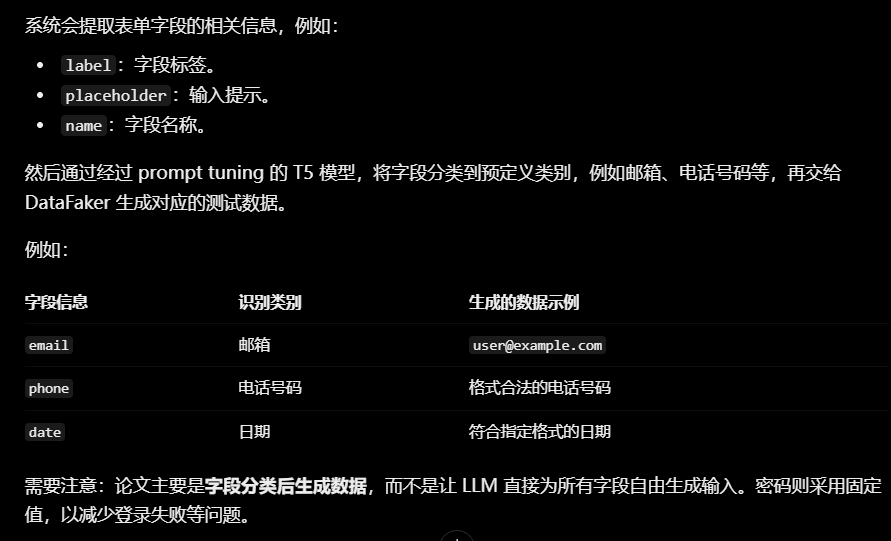
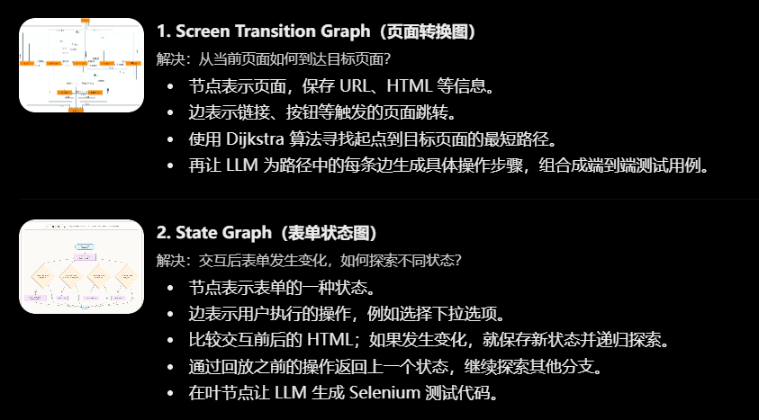
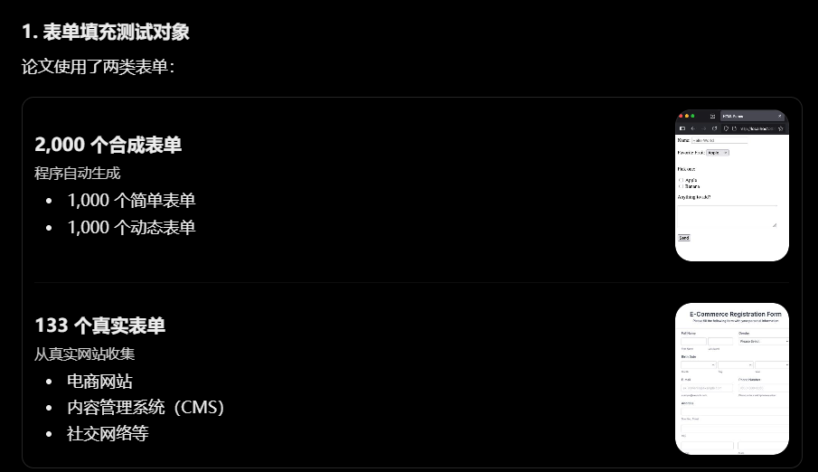
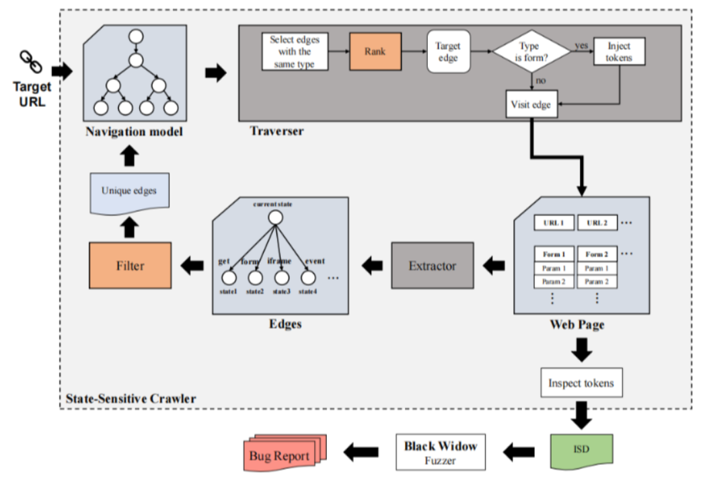

# 第一次汇报

1. 依赖追踪数据

   | 应用       | 表单 优化7 / 对照 | 覆盖率 优化7 / 对照 |
   | :--------- | :---------------- | :------------------ |
   | WordPress  | 7 / 9             | 52627 / 55678       |
   | Drupal     | 31 / 63           | 49780 / 73068       |
   | OpenCart   | 7 / 1             | 17430 / 20559       |
   | ImpressCMS | 12 / 14           | 23878 / 22232       |
   | phpBB      | 62 / 35           | 48242 / 47054       |
   | Kanboard   | 17 / 43           | 10987 / 12722       |

2. 表单智能填充数据（旧版）

   | 应用       | 表单 优化8 / 对照 | 覆盖率 优化8 / 对照 |
   | :--------- | :---------------- | :------------------ |
   | WordPress  | 9 / 9             | 58480 / 55678       |
   | Drupal     | 14 / 63           | 48125 / 73068       |
   | OpenCart   | 2 / 1             | 19416 / 20559       |
   | ImpressCMS | 15 / 14           | 21159 / 22232       |
   | phpBB      | 55 / 35           | 49169 / 47054       |
   | Kanboard   | 27 / 43           | 10654 / 12722       |

3. 依赖追踪做了什么（删除/未删除）

   **请求与跳转捕捉**
   

   重写网页跳转函数XHR/Fetch捕获跳转请求 and 捕捉href标签

   **重复依赖不重复发奖**
   重复依赖仍然可以按照该顺序点击，但是不重复发奖

   **把没跳转的链接也加入队列**

   **签名边持久化（改bug）**

   当爬虫跳到一个新页面时，如何记住“上一个页面上有哪些按钮是有关联的”，以便后续能回来继续点击它们。

   **跨页链接过滤（撤销）**

   把不少真依赖当成「公共导航」丢掉。

4. 依赖追踪数据分析

   不好：优化4把一些低价值页面加进来了，比如没跳转的侧栏/菜单的 href 

   好：优化4增加了页面多样性

   依赖追踪看起来没起作用的原因：这些应用依赖本来就不多

5. 依赖追踪创新点

   依赖评分：优先点击高价值依赖

   依赖复用：如果页面DOM大致相同，可以直接复用依赖

   依赖过滤

   ？？复杂web页面应用依赖层数多吗

6. 其它创新点

   页面价值排序，有限爬取高价值页面

7. 组会汇报什么？时间控制在几分钟内？（EvoCrawl论文+改进+下一步做什么）

8. LLM表单智能填充改进

   最小搭建方案（现针对表单提交能力搭建，然后再逐步扩展到所有页面元素）

   1. 使用爬虫遍历网站爬取HTML
   2. HTML 解析
   3. 数据压缩：对公共 DOM 子树去重，仅保留差异部分
   4. LLM 生成：将压缩结果交给模型，用LLM分析页面生成交互规则
   5. 代码执行：让EvoCrawl根据LLM规则执行

   

   研究以下两项关键技术/技术难点

   1. 跨页面模板识别与去重：识别不同页面共享的导航栏、页脚、侧边栏和重复 DOM 子树，只保留公共模板及各页面的差异部分。

   2. 整站交互关系建模：除了记录页面 HTML，还可以建立跳转关系。例如：哪个按钮可能进入哪个页面，哪个表单提交后会改变当前状态。

   不用LLM提取语义，用LLM写代码提取关键词

   改prompt，根据规则

   提取关键字改规则

做页面间功能间的依赖，把导致它跳转到下一个页面的所有东西都记录下来，截获导致漏洞

值依赖+LLM表单智能填充

在EvoCrawl的页面收集模块（PM）中，种子被定义为 `<URL, EVENT>` 元组。这意味着，一个种子的完整含义是：“在某个URL页面上，触发某个特定的DOM事件”。如果只记录URL，爬虫只能到达页面，却无法重现该页面上“点击某个按钮后展开的表单”或“选中某个选项后才出现的隐藏输入框”这类状态。把事件加入种子，爬虫才能精准回到那个需要特定交互才能呈现的页面状态。

LLM表单智能填充没有数据，有人做过？

依赖过滤也有人做过吗？

？？复杂web页面应用依赖层数多吗

做页面间功能间的依赖，把导致它跳转到下一个页面的所有东西都记录下来，截获导致漏洞

值依赖+LLM表单智能填充

| 注入位置               | 样例值                        | 说明                                                         |
| :--------------------- | :---------------------------- | :----------------------------------------------------------- |
| HTML 标签中            | ``   | 最基础的样例，测试直接注入脚本标签。                         |
| HTML 属性（双引号）    | `">` | 闭合双引号属性值后再注入标签。                               |
| HTML 属性（单引号）    | `'>` | 闭合单引号属性值后再注入标签。                               |
|                        |                               |                                                              |
| JavaScript 字符串      | `';alert(1)//`                | 闭合 JavaScript 单引号字符串后执行代码，`//` 注释掉后面的内容。 |
| URL 上下文（href/src） | `javascript:alert(1)`         | 利用 `javascript:` 伪协议在链接或资源属性中执行代码。        |

# 第二次汇报

1. 问题（再重复筛一遍，我不太相信AI）

   * LLM表单智能填充没有数据，有人做过？

     **Using Large Language Model to Fill in Web Forms to Support Automated Web Application Testing**

     

     有表单去重和输入值复用，没有跨表单的记忆值复用

     **Automated Web Application Testing: End-to-End Test Case Generation with Large Language Models and Screen Transition Graphs**

     表单状态图很有意思

     

     

     测试对象可以复用，算了，数据集不公开

     

     

     | 任务                       | 主要负责人          | 具体作用                                                     |
     | :------------------------- | :------------------ | :----------------------------------------------------------- |
     | 页面导航图构建             | Selenium 自动化程序 | 遍历页面链接和按钮，构建 Screen Transition Graph（屏幕转换图） |
     | 导航路径规划               | 图搜索算法          | 利用 Dijkstra 等算法寻找页面间的路径                         |
     | 导航操作描述与测试场景生成 | LLM                 | 理解交互操作的语义，辅助生成端到端导航测试场景               |
     | 动态表单状态探索           | Selenium 自动化程序 | 执行交互、检测页面状态变化、记录状态并探索其他分支           |
     | 表单测试代码生成           | LLM                 | 根据表单及交互信息生成 Selenium 测试代码，包括定位元素、输入值、点击按钮等操作 |

     不保证把字段格式约束提取出来，根据失败结果修正字段填充规则的反馈机制

     **Does Live Browser Context Improve LLM-Assisted End-to-End Test Script Repair? An Empirical Study of Playwright MCP**

     借鉴：为什么要提取字段呢，不能直接让LLM操作网页吗

     

     

     

     **llm_as_dom**:当能用规则检测的置信度低于阈值（0.6）时，才升级到 LLM 处理，否则用规则决策

     **CN122154648A入院评估单自动生成系统**：用户通过语音录入信息，系统将语音转为文本后送入大语言模型，模型从知识库中匹配对应的评估题目和答案规范，再根据这些内容生成格式化的答案并填入入院评估单，包含LLM自动修正

     **CN122242452A正则表达式生成优化方法**：它做的是**用大语言模型智能体自动生成和优化正则表达式**：流程包括规则输入、语义解析、RAG检索、生成初始正则、测试匹配、失败分析与修复、全库冲突检测、输出结果。它的修复机制针对的是测试环节发现的**漏报、误报及性能缺陷**，最终输出可直接用于DLP、ETL等业务系统的标准化规则。

     **博洛尼亚大学硕士论文**：面向企业低代码平台，用 LLM 生成表单配置 schema，并在结构化校验错误反馈下自修复重试的表单配置生成系统。

     区分度：增加记忆复用，比如之前填入名字X，之后在不同表单碰到名字字段的时候直接复用

     

     区分度：构建字段依赖图，当字段 B 依赖字段 A 时，模型不仅要考虑 B 的取值，还要考虑 A 的状态和二者的约束。修复结果也可以附带适用条件，避免把偶然成功的输入误认为普遍有效的规则。

   * 依赖过滤也有人做过吗？

     网页模板去噪（Boilerplate Removal）：识别多个页面重复出现的侧边栏、导航栏、页脚等公共区域，并将其过滤。

     

   * 复杂web页面应用依赖层数多吗

     多

     步骤 1（填基本信息） -> 步骤 2（上传证件） -> 步骤 3（填写背景调查） -> 步骤 4（电子签名） -> 步骤 5（提交审核）。

   * 不用LLM提取语义，用LLM写代码提取关键词，改prompt，根据规则，提取关键字改规则

     我认为还是需要结合报错的，因为报错是后台显示的规则信息，只看前台的话规则是不完善的

     回去找例子

     结合报错生成规则

     1. 用户填写报销单，“发票号码”的格式规则取决于“发票类型”字段的值。如果类型是“增值税专用发票”，号码必须是 8 位数字；如果是“普通发票”，号码可能是 20 位数字加字母。这个“类型-格式”的映射表如果只维护在后端（比如存在数据库里，且会动态更新），前端手里就没有完整的规则表。

1. **SSBW**

   

   亮点一：不再重复访问相似状态，并且状态过滤方法由视觉分析和文本内容分析转变成分析相似URL和相似表单不再需要分析页面

   *   相似URL：协议、域名、路径、GET参数列表基本一致，仅路径中某一项或某个参数值不同（例如 `/product.php?id=1` 和 `/product.php?id=2`）。
   *   相似表单：不仅所在页面URL相似，表单的 `action` 属性相似和参数列表相同。

   亮点二：顺序不再是FIFO而是按照导致它跳转的表单有多少参数，因为这代表着填写完这个表单后的页面状态更有可能发现漏洞

   > DOM型：不经过服务器（服务器响应里面没有payload），不经过数据库
   >
   > 反射型：经过服务器，不经过数据库
   >
   > 存储型：经过服务器，经过数据库

   **痛点一：【点了一个按钮，URL 根本没变，但页面内容变了】这种状态难以建模**

   **痛点二：【只有当用户先买了“A商品”，又评价了“B商品”，最后在“C页面”提交一段文字时，系统才会把那行文字吐出来】这种页面之间的顺序依赖难以发现**

   一个点依赖于2个点

   

   页面过滤可能没考虑当前状态没有满足前置情况

   

   找到这样的例子

   

   **EvoCrawl**

   **痛点一：需重新登录/切换session的漏洞（权限切换场景下的 XSS 触发困难）**

   方向一：EvoCrawl适应度函数参数自动优化

   方向二：高度相似页面重复爬取，可以借助SSBW的方法，但是不知道是不是算抄袭

   

   文件上传漏洞、SQL注入漏洞等

   

   SPAFuzz看一下

   

   看一下wordpress提交了的漏洞数（找最小的应用）

   

   

   覆盖率去掉描述性语言？

   把漏洞检测器杂糅在一起，把测试样例一股脑丢进去（？）

   

   

   

   
